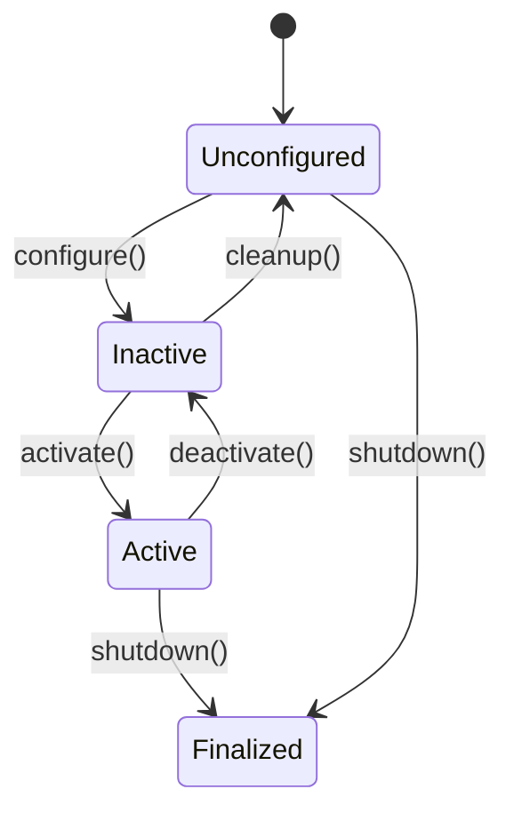

# 🤖 TurtleBot3 SLAM Mapping & Autonomous Waypoint Navigation

[](https://docs.ros.org/)
[](https://navigation.ros.org/)
[](https://github.com/SteveMacenski/slam_toolbox)
[](https://gazebosim.org/)
[](https://github.com/Nasim-Sami)

> An end-to-end autonomous mobile robotics pipeline covering real-time SLAM (Simultaneous Localization and Mapping), map serialization, map-based AMCL localization, Nav2 lifecycle management, and programmable multi-waypoint patrol using the Python `nav2_simple_commander` API.

---

## 📹 Video Demonstration

A full demonstration screencast is included directly in this directory:
- 🎬 **Video File:** [`turtlebot3_slam_navigation_demo.webm`](turtlebot3_slam_navigation_demo.webm)
- **Watch in Linux Terminal:**
  ```bash
  vlc turtlebot3_slam_navigation_demo.webm
  # or
  ffplay turtlebot3_slam_navigation_demo.webm
  ```

---

## 📌 Project Overview

This project implements a complete autonomous navigation workflow for a differential-drive robot (**TurtleBot3 Waffle**) inside a simulated arena:

1. **Mapping with SLAM Toolbox**: The robot starts with no prior knowledge of its surroundings. As it explores the hexagonal arena, laser scan data (`/scan`) and wheel odometry (`/odom`) are fused by SLAM Toolbox to generate an occupancy grid map in real time.
2. **Map Serialization**: Saving the generated 2D grid into persistent `.yaml` (metadata) and `.pgm` (occupancy image) files.
3. **Map-Based Localization & Navigation**: Launching Nav2 with the saved map. Nav2 utilizes Costmaps (Global & Local), Planners (NavFn / Smac), and Controllers (DWB / MPPI / Regulated Pure Pursuit).
4. **Lifecycle Management Control (`autostart:=False`)**: Explicitly managing the Nav2 lifecycle state machine for safety and deterministic initialization.
5. **Autonomous Multi-Waypoint Follower**: A Python script (`turtlebot3_waypoint_navigator.py`) using `nav2_simple_commander` to autonomously patrol a custom set of arena coordinates without manual operator intervention.

---

## ⚙️ Prerequisites & Tool Installation

Ensure you have your ROS 2 environment sourced. Replace `$ROS_DISTRO` with your installed distribution (e.g., `lyrical`, `jazzy`, or `humble`):

```bash
# Update package repositories
sudo apt update

# Install Nav2 bringup, SLAM Toolbox, and simulation utilities
sudo apt install -y \
  ros-$ROS_DISTRO-nav2-bringup \
  ros-$ROS_DISTRO-slam-toolbox \
  ros-$ROS_DISTRO-turtlebot3-gazebo \
  ros-$ROS_DISTRO-nav2-simple-commander \
  ros-$ROS_DISTRO-teleop-twist-keyboard

# Set the TurtleBot3 model (add this to your ~/.bashrc for persistence)
export TURTLEBOT3_MODEL=waffle
```

---

## 🚀 Step-by-Step Execution Guide

### Phase 1: Real-Time SLAM Mapping (Zero Prior Knowledge)

In this phase, the robot starts in an unknown environment and builds the map from scratch.

#### Step 1.1: Launch Gazebo Simulation in SLAM Mode
```bash
ros2 launch nav2_bringup tb3_simulation_launch.py headless:=False slam:=True
```

> [!NOTE]
> **Why SLAM eliminates the "2D Pose Estimate" headache:**
> In pre-mapped AMCL localization, the user must provide an initial pose estimate so the particle filter knows where the robot is. In SLAM mode (`slam:=True`), the robot's starting position is designated as `(0, 0, 0)` in the map frame, and SLAM Toolbox continuously publishes the `map → odom` TF transform itself.

#### Step 1.2: Explore the Arena to Expand the Map
You can drive the robot around using either RViz goals or keyboard teleoperation:

* **Option A — Keyboard Teleoperation:**
  ```bash
  ros2 run teleop_twist_keyboard teleop_twist_keyboard --ros-args -p stamped:=true
  ```
  *(Note: Modern ROS 2 simulations use `geometry_msgs/msg/TwistStamped` for `cmd_vel`, hence `-p stamped:=true`)*

* **Option B — Nav2 Goal:**
  In RViz, click **Nav2 Goal** and click on known (white) areas near the robot. As the robot moves, new walls and obstacles appear on the occupancy grid.

#### Step 1.3: Save the Completed Map
Once the entire arena is mapped, open a new terminal and serialize the map:
```bash
# Save to ~/my_map.yaml and ~/my_map.pgm
ros2 run nav2_map_server map_saver_cli -f ~/my_map
```
*(If a subscription timeout occurs due to QoS policies, add transient local flags:)*
```bash
ros2 run nav2_map_server map_saver_cli -f ~/my_map --ros-args -p save_map_timeout:=10.0 -p map_subscribe_transient_local:=true
```

---

### Phase 2: Navigation with Pre-Built Map & Lifecycle Management

Once the map is saved, stop the SLAM launch (`Ctrl + C` and `ros2 daemon stop`).

#### Step 2.1: Launch Nav2 with `autostart:=False`
Run the simulation loading your newly saved map:
```bash
ros2 launch nav2_bringup tb3_simulation_launch.py headless:=False autostart:=False map:=$HOME/my_map.yaml
```

---

### 🧠 Deep Dive: Why `autostart:=False`?

In ROS 2 Navigation2, all core systems (`planner_server`, `controller_server`, `bt_navigator`, `map_server`, `amcl`) are implemented as **Managed Lifecycle Nodes**:



- **When `autostart:=True` (Default):**
  The lifecycle manager immediately commands all nodes from `Unconfigured` $\rightarrow$ `Inactive` $\rightarrow$ `Active` on startup. If the map has not loaded or the initial pose is unlocalized, planners or controllers can throw errors or crash.
- **When `autostart:=False` (Production Best Practice):**
  All nodes remain in the `Inactive` / `Unconfigured` state. In RViz, the **Nav2 Lifecycle Manager panel** displays a **"Startup"** button. This gives the operator full control to:
  1. Inspect RViz to verify that the map is rendered correctly.
  2. Set the initial robot location if needed.
  3. Click **"Startup"** in RViz to transition all lifecycle nodes into `Active` state deterministically.

---

### Phase 3: Collecting Coordinates & Autonomous Waypoint Navigation

Instead of clicking manually on RViz every time, we automate the mission using Python and `nav2_simple_commander`.

#### Step 3.1: Gathering Coordinates via RViz
1. Open a terminal and listen to clicked points:
   ```bash
   ros2 topic echo /clicked_point
   ```
2. In RViz, click **Publish Point** from the top toolbar, then click anywhere on the arena floor.
3. The terminal instantly prints the exact $(x, y)$ coordinates:
   ```yaml
   point:
     x: 0.83
     y: -2.00
     z: 0.0
   ```
4. Collect 4–5 coordinates forming a patrol circuit around the hexagon arena.

#### Step 3.2: Run the Waypoint Follower Script
With the Nav2 simulation running, launch the autonomous script:
```bash
python3 turtlebot3_waypoint_navigator.py
```

#### Terminal Execution Output:
```text
=====================================================
  TurtleBot3 Nav2 Autonomous Waypoint Navigator
=====================================================
[INFO] Waiting for Nav2 stack to become active...
[SUCCESS] Nav2 is active! Commencing autonomous patrol...

--> [Waypoint 1/5] Dispatching goal: (-0.67, -2.12)
[REACHED] Waypoint 1 arrived successfully! ✓

--> [Waypoint 2/5] Dispatching goal: (0.83, -2.00)
[REACHED] Waypoint 2 arrived successfully! ✓

--> [Waypoint 3/5] Dispatching goal: (2.10, -0.53)
[REACHED] Waypoint 3 arrived successfully! ✓

--> [Waypoint 4/5] Dispatching goal: (1.64, 1.37)
[REACHED] Waypoint 4 arrived successfully! ✓

--> [Waypoint 5/5] Dispatching goal: (-0.70, 1.78)
[REACHED] Waypoint 5 arrived successfully! ✓

=====================================================
  All waypoints reached successfully! Mission complete.
=====================================================
```

> [!TIP]
> **Why `navigator.lifecycleShutdown()` is commented out:**
> Calling `lifecycleShutdown()` instructs Nav2's lifecycle manager to shut down all servers. If you wish to rerun `python3 turtlebot3_waypoint_navigator.py` multiple times without restarting the Gazebo simulation each time, keep `lifecycleShutdown()` commented out!

---

## 📂 Directory Structure

```text
01_TurtleBot3_SLAM_and_Autonomous_Navigation/
├── README.md                              # This comprehensive project documentation
├── turtlebot3_waypoint_navigator.py       # Autonomous multi-waypoint patrol script
├── turtlebot3_slam_navigation_demo.webm   # Recorded simulation screencast
└── maps/
    ├── my_map.yaml                        # Map metadata (resolution, origin, thresholds)
    └── my_map.pgm                         # 2D Occupancy grid image
```

---

## 🛠️ Troubleshooting Guide

| Issue | Cause | Solution |
| :--- | :--- | :--- |
| `WARNING: topic [/goal_pose] does not appear to be published` | `/goal_pose` has no active publisher yet | Specify type: `ros2 topic echo /goal_pose geometry_msgs/msg/PoseStamped` or use `/clicked_point` with RViz **Publish Point**. |
| Robot does not move with keyboard teleop | Topic expects `TwistStamped` rather than raw `Twist` | Pass stamped flag: `ros2 run teleop_twist_keyboard teleop_twist_keyboard --ros-args -p stamped:=true`. |
| Second script run hangs at `Waiting for Nav2 to become active...` | Previous run executed `navigator.lifecycleShutdown()` | Comment out `# navigator.lifecycleShutdown()` in the python script. |
| Map saver times out | Transient local QoS mismatch | Add `-p map_subscribe_transient_local:=true` to `map_saver_cli`. |

---

## 👤 Author
**Nasim Sami**  
- GitHub: [@Nasim-Sami](https://github.com/Nasim-Sami)
- Portfolio Repository: [ROS2-Mini-Projects](https://github.com/Nasim-Sami/ROS2-Mini-Projects)
