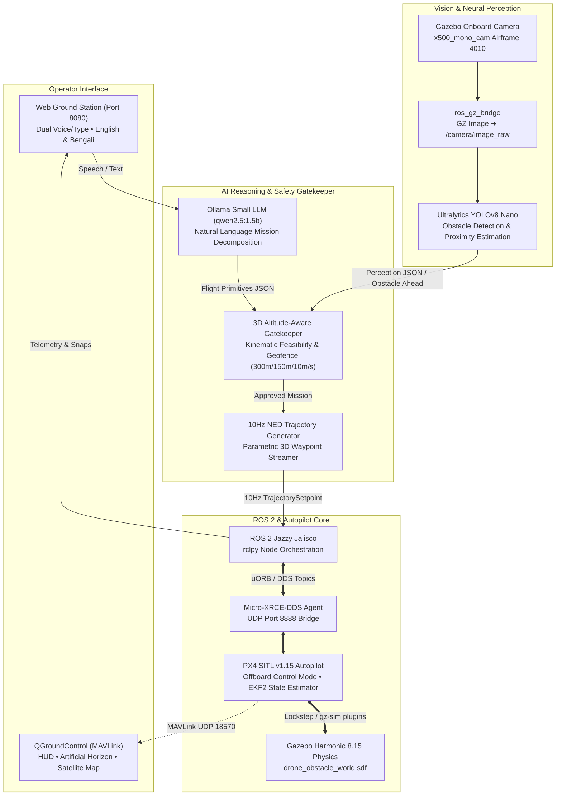

# 🚁 Autonomous Aerial Robotics: PX4 SITL + ROS 2 Jazzy + Gazebo Harmonic + YOLOv8 + Small LLM

<div align="center">

[](https://docs.ros.org/en/jazzy/)
[](https://px4.io/)
[](https://gazebosim.org/)
[](http://qgroundcontrol.com/)
[](https://ollama.ai/)
[](https://ultralytics.com/)
[](../LICENSE)
[](https://github.com/Nasim-Sami)

**An end-to-end, production-grade autonomous quadcopter pipeline featuring Natural Language Mission Planning (English & Bengali), a Physics-based 3D Safety Gatekeeper, Real-time YOLOv8 Computer Vision Perception, and PX4 Offboard Trajectory Tracking.**

[System Architecture](#-system-architecture) • [Key Features](#-key-features) • [Installation](#-installation--setup) • [Quick Start](#-step-by-step-execution-guide) • [Verification Tests](#-verification-and-benchmark-suite)

</div>

---

## 📖 Overview

This project implements a complete autonomous aerial robotics stack designed for real-world inspection and surveillance missions. Operators can command the quadcopter through speech or natural language text in either **English** or **Bengali** (e.g., *"Take off to 10 meters, go forward 15 meters, take a photo"* or *"সামনে ৫ মিটার যাও"*). 

The mission command is processed through an on-device Small Language Model (**Ollama `qwen2.5:1.5b`**) into structured flight primitives. Before sending any flight setpoint to the drone, a deterministic **3D Altitude-Aware Trajectory Gatekeeper** evaluates environmental perception from an onboard **Ultralytics YOLOv8** neural network and current telemetry. If an obstacle is detected in the flight corridor at low altitude, the mission is rejected with an actionable safety warning. If the drone is commanded to cruise safely above the obstacle height ($\ge 3.0\text{ m}$), safe overflight clearance is granted and the drone flies smoothly in Gazebo Harmonic while streaming telemetry to both a custom **Web Ground Station** and **QGroundControl**.

---

## 🏗️ System Architecture



---

## ✨ Key Features

### 1. Dual Voice & Text Ground Control Station
- Responsive browser-based dashboard hosted at `http://localhost:8080`.
- Real-time bilingual speech recognition (English and Bengali) using Web Speech API with explicit audio-visual listening indicators (pulsing red indicator, soundwave animations, audio chimes).
- Editable transcription preview before mission dispatch.

### 2. 3D Altitude-Aware Trajectory Gatekeeper
- **10x Expanded Flight Boundaries**: Max ceiling $150.0\text{ m}$, Geofence radius $300.0\text{ m}$, Max flight speed $10.0\text{ m/s}$.
- **Vertical Overflight Logic**: If ground obstacle (human, SUV, bus) is detected at distance $< 4.0\text{ m}$:
  - If current altitude $z < 3.0\text{ m}$: **REJECTED** with obstacle warning.
  - If current altitude $z \ge 3.0\text{ m}$: **APPROVED** with logged vertical clearance.
- **State-Aware Auto-Repair**: Automatically prepends a deterministic takeoff maneuver if aerial commands are issued while the drone is grounded.

### 3. Onboard YOLOv8 Aerial Perception
- Ultralytics YOLOv8 Nano running real-time inference on the `/camera/image_raw` stream.
- Center-corridor proximity calculation and threat classification (`person`, `car`, `bus`, `truck`, `box`).
- Snapshots triggered dynamically on `"take a photo"` commands and immediately served to the web dashboard.

### 4. PX4 SITL Offboard Flight & QGroundControl HUD
- Native PX4 v1.15 offboard control via Micro-XRCE-DDS middleware.
- Full EKF2 sensor fusion: IMU, Barometer (`AirPressure`), Magnetometer (`Magnetometer`), and GPS (`NavSat`).
- Simultaneous telemetry streaming to QGroundControl for real-time aeronautical HUD, artificial horizon, and satellite map tracking.

---

## 📦 Prerequisites

- **Host OS**: Ubuntu 24.04 / 22.04 LTS (Linux x86_64)
- **Container Engine**: Docker CE with Hardware GPU Acceleration (`/dev/dri`)
- **LLM Engine**: Ollama with model `qwen2.5:1.5b`
- **GCS Software**: QGroundControl (`QGroundControl.AppImage`)

---

## 🔧 Installation & Setup

### 1. Install & Verify Ollama LLM
```bash
# Install Ollama (Host)
curl -fsSL https://ollama.com/install.sh | sh

# Pull the lightweight 1.5B parameter model
ollama pull qwen2.5:1.5b

# Verify Ollama service is active
systemctl is-active ollama
```

### 2. Download QGroundControl (Host)
```bash
# Download latest stable AppImage
wget https://d176tv9ibo4jno.cloudfront.net/latest/QGroundControl.AppImage -O ~/QGroundControl.AppImage

# Make executable
chmod +x ~/QGroundControl.AppImage
```

### 3. Build / Launch Docker Container
The simulation runs inside a self-contained Docker container configured with ROS 2 Jazzy, PX4 SITL v1.15, and Gazebo Harmonic:
```bash
cd docker
chmod +x run.sh run_sim.sh
./run.sh
```

---

## 🚀 Step-by-Step Execution Guide

To understand the robotics pipeline mechanics, follow this 5-terminal workflow:

### **Terminal 1: Gazebo Harmonic + PX4 Drone Simulation**
In your host terminal, grant GUI access and enter the container:
```bash
# 1. Allow Docker container to access host X11 display
xhost +local:root

# 2. Attach to persistent container
docker start -ai drone_jazzy_sim_instance
```
Inside the container shell (`root@...:/workspace#`), export environment variables and launch:
```bash
export PX4_GZ_WORLD="drone_obstacle_world"
export PX4_SYS_AUTOSTART=4010
export PX4_SIM_MODEL="x500_mono_cam"
export GZ_CONFIG_PATH="/usr/share/gz${GZ_CONFIG_PATH:+:${GZ_CONFIG_PATH}}"

/opt/px4-gazebo/bin/px4-gazebo
```
* **`PX4_GZ_WORLD="drone_obstacle_world"`**: Loads custom world with human ($4\text{m}$), SUV ($6\text{m}$), and red cube ($3\text{m}$) obstacles.
* **`PX4_SYS_AUTOSTART=4010`**: PX4 airframe ID for `x500_mono_cam` (quadcopter with forward-mounted camera).
* **`GZ_CONFIG_PATH`**: Ensures Gazebo Harmonic finds the `sim` plugin alongside ROS 2 Jazzy vendor packages.

---

### **Terminal 2: Micro-XRCE-DDS Agent**
On the host machine, open a new terminal:
```bash
docker exec -it drone_jazzy_sim_instance bash -c "source /opt/ros/jazzy/setup.bash && MicroXRCEAgent udp4 -p 8888"
```
* Translates PX4 uORB messages to ROS 2 topics (`/fmu/in/*`, `/fmu/out/*`) over UDP port 8888.

---

### **Terminal 3: Onboard Camera Bridge & YOLOv8 Perception**
On the host machine, open a 3rd terminal:
```bash
docker exec -it drone_jazzy_sim_instance /workspace/scripts/start_vision.sh
```
* Bridges Gazebo topic `/world/drone_obstacle_world/model/x500_mono_cam_0/link/camera_link/sensor/camera/image` $\to$ ROS 2 `/camera/image_raw`.
* Launches Ultralytics YOLOv8 real-time detector.

---

### **Terminal 4: Web Ground Control Station (GCS)**
On the host machine, open a 4th terminal:
```bash
docker exec -it drone_jazzy_sim_instance bash -c "source /opt/ros/jazzy/setup.bash && source /opt/px4_ros2/install/setup.bash && python3 /workspace/scripts/web_ground_station.py 8080"
```
* Starts the interactive Web GCS dashboard on port 8080.
* Connects the browser to Ollama, Gatekeeper, and PX4 flight mode publishers.

---

### **Terminal 5: QGroundControl HUD (Host)**
On the host machine, open a 5th terminal:
```bash
~/QGroundControl.AppImage
```
* Connects automatically to PX4 SITL MAVLink broadcast (`UDP 18570 / 14550`).
* Displays Artificial Horizon, Attitude tape, Altitude AGL, and GPS map.

---

## 🧪 Verification and Benchmark Suite

### 1. Browser Mission Scenarios
Open your browser at **`http://localhost:8080`**:

| Scenario | Natural Command (English / Bengali) | Expected Gatekeeper Behavior | Expected Drone Action |
| :--- | :--- | :--- | :--- |
| **Low-Altitude Collision** | `"সামনে ৫ মিটার যাও"` or `"Go forward 5m"` | **REJECTED 🛑** (`Detected 'BUS' ~3.7m ahead. Climb to >=3m`) | Motors remain idle; no flight hazard. |
| **Safe Altitude Climb** | `"Take off to 5 meters"` | **APPROVED ✅** | Spools up motors, climbs to $5.0\text{ m}$, hovers. |
| **High-Altitude Overflight** | `"Take off to 7 meters then go forward 10 meters"` | **APPROVED ✅** (`Overflight Safe: Cruising at 7m (+4m clearance)`) | Climbs to $7.0\text{ m}$, flies forward $10.0\text{ m}$ directly over the car/person. |
| **Aerial Photo Reconnaissance** | `"Take a photo"` or `"ছবি তোলো"` | **APPROVED ✅** | Triggers camera shutter, saves and displays fresh snapshot in UI. |

### 2. Automated 22/22 LLM & Safety Benchmark
Run the standalone regression test suite:
```bash
docker exec -it drone_jazzy_sim_instance bash -c "source /opt/ros/jazzy/setup.bash && python3 -m pytest /workspace/tests/benchmark_test_suite.py -v"
```
```text
============================== 22 passed in 1.48s ==============================
✅ 10/10 Natural Language Intent Tests (English & Bengali) Passed
✅ 12/12 3D Altitude-Aware Collision & Geofence Tests Passed
```

---

## 🛠️ Key Technical Challenges & Solutions

| Technical Challenge | Root Cause | Engineering Solution |
| :--- | :--- | :--- |
| **Gazebo CLI `gz sim` Missing** | Sourcing ROS 2 Jazzy overwrote `GZ_CONFIG_PATH` with vendor paths, hiding `/usr/share/gz/sim8.yaml`. | Explicitly bound `/usr/share/gz` into `GZ_CONFIG_PATH` in `~/.bashrc` and launcher scripts. |
| **PX4 SITL Timed Out on Startup** | World name in SDF was `<world name="default">`, but PX4 searched for `/world/drone_obstacle_world/scene/info`. | Renamed world XML tag to `<world name="drone_obstacle_world">`. |
| **Preflight Check Failed (No Arm)** | Dedicated world SDF was missing Gazebo `AirPressure` (barometer) and `Magnetometer` (compass) plugins. | Added all 11 core Gazebo sensor plugins to `drone_obstacle_world.sdf`. |
| **Drone Propellers Spun but No Lift** | PX4 v1.15 publishes vehicle status on `/fmu/out/vehicle_status_v4`, while GCS subscribed to legacy `/vehicle_status`. | Updated subscription to `/fmu/out/vehicle_status_v4`, enabling immediate detection of `ARMED` state. |

---

## 📄 License

This project is licensed under the MIT License - see the [LICENSE](../LICENSE) file for details.

---

## 👨‍💻 Author

**Nasimul Khaled Sami**  
- GitHub: [@Nasim-Sami](https://github.com/Nasim-Sami)  
- Portfolio: [ROS2-Mini-Projects](https://github.com/Nasim-Sami/ROS2-Mini-Projects)  
- Specialization: Autonomous Aerial Robotics, ROS 2, Embedded Autopilots, AI Perception & LLM Control
