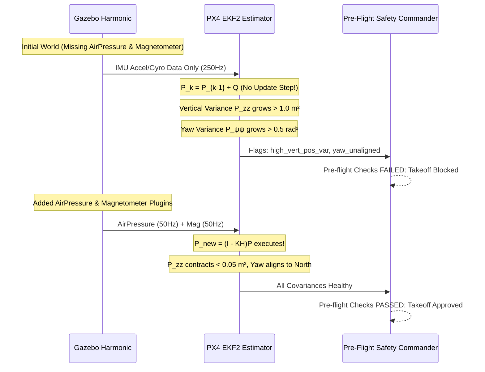
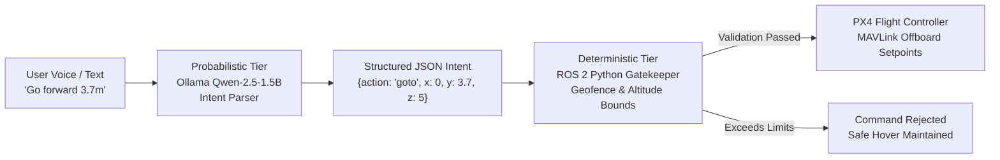

# 📘 Mathematical Foundations & Theoretical Mechanics

This document provides a comprehensive, graduate-level reference for the mathematical derivations, optical physics, spatial kinematics, and estimation theory implemented throughout the autonomous aerial robotics pipeline.

---

# Table of Contents
1. [Optical Physics & Computer Vision](#1-optical-physics--computer-vision)
   - 1.1 [Monocular Pinhole Projection ($D = \frac{H \cdot f}{h}$)](#11-monocular-pinhole-projection-d--frac--cdot-fh)
   - 1.2 [Wave Nature of Light & Bosonic Ray Superposition](#12-wave-nature-of-light--bosonic-ray-superposition)
   - 1.3 [The Monocular Scale Ambiguity Problem & Semantic Priors](#13-the-monocular-scale-ambiguity-problem--semantic-priors)
   - 1.4 [Stereo Vision Triangulation & Disparity ($D = \frac{f \cdot B}{d}$)](#14-stereo-vision-triangulation--disparity-d--fracf-cdot-bd)
2. [Coordinate Frames & Spatial Transformations](#2-coordinate-frames--spatial-transformations)
   - 2.1 [The Frame Conflict: Aviation NED vs Robotics ENU](#21-the-frame-conflict-aviation-ned-vs-robotics-enu)
   - 2.2 [Body Frame ($\mathcal{F}_B$) vs World Inertial Frame ($\mathcal{F}_W$)](#22-body-frame-mathcalf_b-vs-world-inertial-frame-mathcalf_w)
3. [Rotational Kinematics, Gimbal Lock & 4D Quaternions](#3-rotational-kinematics-gimbal-lock--4d-quaternions)
   - 3.1 [Tait-Bryan $Z$-$Y$-$X$ Euler Angles](#31-tait-bryan-z-y-x-euler-angles)
   - 3.2 [Mathematical Derivation of Euler Kinematic Rates](#32-mathematical-derivation-of-euler-kinematic-rates)
   - 3.3 [The Mathematical Catastrophe of Gimbal Lock ($\div 0$)](#33-the-mathematical-catastrophe-of-gimbal-lock-div-0)
   - 3.4 [Mechanical Gimbal Rings vs Industrial Manipulator Singularities](#34-mechanical-gimbal-rings-vs-industrial-manipulator-singularities)
   - 3.5 [Hamilton's 4D Quaternion Algebra on $S^3$](#35-hamiltons-4d-quaternion-algebra-on-s3)
   - 3.6 [The Quaternion Sandwich Operator ($p' = q \cdot p \cdot q^*$)](#36-the-quaternion-sandwich-operator-p--q-cdot-p-cdot-q)
   - 3.7 [Conversion to Orthogonal Rotation Matrix $R(q) \in SO(3)$](#37-conversion-to-orthogonal-rotation-matrix-rq-in-so3)
4. [Sensor Fusion & Extended Kalman Filtering (EKF2)](#4-sensor-fusion--extended-kalman-filtering-ekf2)
   - 4.1 [The Sensor Dilemma in Aerial Robotics](#41-the-sensor-dilemma-in-aerial-robotics)
   - 4.2 [Error Covariances & Dimensional Analysis ($P, Q, R$)](#42-error-covariances--dimensional-analysis-p-q-r)
   - 4.3 [Linear vs Nonlinear Transformations on Gaussian Distributions](#43-linear-vs-nonlinear-transformations-on-gaussian-distributions)
   - 4.4 [First-Order Taylor Series & Jacobian Linearization](#44-first-order-taylor-series--jacobian-linearization)
   - 4.5 [Derivation of the Kalman Gain ($K$)](#45-derivation-of-the-kalman-gain-k)
   - 4.6 [Derivation of the Posterior Covariance Update ($P_{\text{new}}$)](#46-derivation-of-the-posterior-covariance-update-p_textnew)
   - 4.7 [Root-Cause Analysis: Why Missing Gazebo Plugins Blocked Takeoff](#47-root-cause-analysis-why-missing-gazebo-plugins-blocked-takeoff)
   - 4.8 [Clean Python Reference Implementation](#48-clean-python-reference-implementation)
5. [Deterministic Safety & Autonomous Supervisory Control](#5-deterministic-safety--autonomous-supervisory-control)
   - 5.1 [3D Altitude-Aware Gatekeeper Geometry](#51-3d-altitude-aware-gatekeeper-geometry)
   - 5.2 [10Hz Heartbeat & Dead Man's Switch Failsafe](#52-10hz-heartbeat--dead-mans-switch-failsafe)
   - 5.3 [Two-Tier Architecture: Probabilistic LLM + Deterministic ROS 2 Shield](#53-two-tier-architecture-probabilistic-llm--deterministic-ros-2-shield)

---

# 1. Optical Perception & Computer Vision

## 1.1 Monocular Pinhole Projection ($D = \frac{H \cdot f}{h}$)

The onboard monocular camera is modeled as an ideal pinhole camera projection. Consider an optical center $O$, an image sensor plane placed at focal distance $f$ along the optical axis, and a 3D real-world object of metric height $H$ situated at distance $D$ along the optical axis.

```text
               Real World Object
                     A
                     |
                     |  Physical Height = H
                     |
                     B
       <------------- D ------------->
              (Object Distance Z)
---------------------+--------------------- (Optical Axis)
                     |
             Optical Center (O)
                     |
        <--- f --->  |
       (Focal Length)|
               a     |
               |     |
    Image Size |     |
          (h)  |     |
               b     |
           Sensor Image Plane
```

### Geometric Proof via Similar Triangles ($\triangle$):
1. Let the endpoints of the object in 3D camera coordinates be $A = (X, Y_A, D)$ and $B = (X, Y_B, D)$ where $H = |Y_A - Y_B|$.
2. Let the projected endpoints on the sensor plane at $Z = f$ be $a = (x, y_a)$ and $b = (x, y_b)$ where $h = |y_a - y_b|$.
3. Two pairs of right triangles are formed: $\triangle OAB$ in world space and $\triangle Oab$ in image space.
4. Because optical rays travel in straight lines:
   $$\angle AOB = \angle aOb \quad (\text{Vertical Opposite Angles})$$
   $$\angle OBA = \angle Oba = 90^\circ$$
5. Therefore, $\triangle OAB \sim \triangle Oab$ (Similar Triangles). By the ratio of corresponding sides:
   $$\frac{\text{Image Height } (h)}{\text{Real Height } (H)} = \frac{\text{Focal Distance } (f)}{\text{Object Distance } (D)}$$
   $$\frac{h}{H} = \frac{f}{D}$$
6. Rearranging for metric distance $D$:
   $$D = \frac{H \cdot f}{h}$$
   $$\text{Q.E.D.}$$

---

## 1.2 Wave Nature of Light & Bosonic Ray Superposition

A fundamental physical question arises in pinhole optics:
> *If thousands of rays from diverse objects (e.g. a tree, a table, the sky) pass through an infinitesimal pinhole simultaneously, why do they not collide, scatter, or blur each other like particles in a traffic jam?*

This phenomenon is explained by classical electrodynamics and quantum statistical mechanics:

### 1. Principle of Linear Superposition (Classical Electrodynamics)
In vacuum and standard atmospheric air, Maxwell's equations are strictly linear:
$$\nabla \cdot \mathbf{E} = 0, \quad \nabla \times \mathbf{E} = -\frac{\partial \mathbf{B}}{\partial t}$$
When two electromagnetic wave packets $\mathbf{E}_1(\mathbf{r}, t)$ and $\mathbf{E}_2(\mathbf{r}, t)$ cross at spatial coordinate $\mathbf{r}_{\text{pinhole}}$, their fields sum vectorially:
$$\mathbf{E}_{\text{total}} = \mathbf{E}_1 + \mathbf{E}_2$$
The waves pass directly through each other without altering their respective wavevectors $\mathbf{k}_1, \mathbf{k}_2$, frequencies $\omega$, or trajectories.

### 2. Quantum Statistics: Photons are Bosons, Not Fermions
* Solid matter (electrons, atoms, salt, sugar) consists of **Fermions** with half-integer spin ($s = 1/2$). Fermions obey the Pauli Exclusion Principle: two fermions cannot occupy the exact same quantum state or spatial point simultaneously, causing mechanical collisions and bulk displacement.
* Light consists of **Photons**, which are **gauge Bosons** with integer spin ($s = 1$). Bosons obey Bose-Einstein statistics and do not obey the exclusion principle. Trillions of photons can traverse the exact same spatial volume simultaneously with zero mutual interaction.
* As a result, the rectilinear propagation maps each 3D world direction to a unique 2D coordinate on the sensor without mutual interference.

---

## 1.3 The Monocular Scale Ambiguity Problem & Semantic Priors

Because a monocular sensor performs a projection from $\mathbb{R}^3 \to \mathbb{R}^2$, depth information along the ray is lost:
$$\begin{bmatrix} u \\ v \end{bmatrix} = \frac{f}{Z} \begin{bmatrix} X \\ Y \end{bmatrix}$$
A small object close to the lens and a huge object far away project to identical pixel dimensions:
$$\frac{h_{\text{toy}}}{D_{\text{near}}} = \frac{h_{\text{real}}}{D_{\text{far}}}$$

### Resolution via Semantic Class Priors ($H_{\text{prior}}$):
Our vision perception architecture integrates YOLOv8 deep neural inference. When YOLOv8 classifies a detected bounding box with semantic label $c \in \mathcal{C}$, the system indexes a Gaussian prior of physical dimensions:
$$H \sim \mathcal{N}(\mu_{H, c}, \sigma_{H, c}^2)$$
* For class `person`: $\mu_H = 1.70\text{m}, \sigma_H = 0.08\text{m}$
* For class `car`: $\mu_H = 1.45\text{m}, \sigma_H = 0.05\text{m}$

Substituting $\mu_{H, c}$ into the pinhole equation resolves metric distance with $\pm 5-10\%$ uncertainty, sufficient for high-level obstacle safety margins ($2.5\text{m}$ clearance).

---

## 1.4 Stereo Vision Triangulation & Disparity ($D = \frac{f \cdot B}{d}$)

Stereo systems employ two coplanar pinhole cameras separated by baseline distance $B$ along the horizontal $X$-axis.

```text
                           P (3D Point in World)
                          / \
                         /   \
                        /     \
                       /   |   \
                      /    | D  \
                     /     |     \
                    /      |      \
        Left Optical Center        Right Optical Center
              O_L <------- B -------> O_R
              | |                     | |
              |x_L|                   |x_R|
           Left Sensor             Right Sensor
```

### Derivation:
1. Define coordinate origin at the left camera center $O_L = (0, 0, 0)$. The right camera center is $O_R = (B, 0, 0)$.
2. Let target 3D world point be $P = (X, Y, D)$ where depth $Z = D$.
3. Projection onto the left image plane ($x_L$):
   $$\frac{x_L}{f} = \frac{X}{D} \implies x_L = \frac{f \cdot X}{D}$$
4. Projection onto the right image plane ($x_R$), where relative horizontal position is $(X - B)$:
   $$\frac{x_R}{f} = \frac{X - B}{D} \implies x_R = \frac{f \cdot (X - B)}{D}$$
5. Define disparity $d$ as the horizontal pixel coordinate difference:
   $$d = x_L - x_R = \frac{f \cdot X}{D} - \frac{f \cdot (X - B)}{D}$$
   $$d = \frac{f}{D} [X - (X - B)] = \frac{f \cdot B}{D}$$
6. Solving for metric depth $D$:
   $$D = \frac{f \cdot B}{d}$$
   $$\text{Q.E.D.}$$

> **Key Theoretical Takeaway:** Notice that physical height $H$ has completely vanished from the formulation. Stereo vision extracts metric depth to arbitrary, unknown, or unclassified obstacles without requiring semantic size priors.

---

# 2. Coordinate Frames & Spatial Transformations

## 2.1 The Frame Conflict: Aviation NED vs Robotics ENU

Autonomous drone software operates at the intersection of two distinct coordinate conventions:

```text
       Aviation Frame (NED)                 Robotics Frame (ENU)
             +X (North)                         +Y (North)
                 ^                                  ^
                 |                                  |
                 |                                  |
      <----------+----------> +Y (East)  <----------+----------> +X (East)
     -Y          |                      -X          |
                 |                                  |
                 v                                  v
             +Z (Down - into Earth)             +Z (Up - into Sky)
```

1. **Aviation / PX4 SITL (NED):**
   - Axis orientation: $X \to \text{North}, Y \to \text{East}, Z \to \text{Down}$.
   - Altitude is negative: climbing to $5\text{m}$ means setpoint $Z = -5.0\text{m}$.
2. **Robotics / ROS 2 / Gazebo (ENU - REP 103):**
   - Axis orientation: $X \to \text{East}, Y \to \text{North}, Z \to \text{Up}$.
   - Altitude is positive: climbing to $5\text{m}$ means setpoint $Z = +5.0\text{m}$.

### Frame Transformation Mapping:
Sending ROS 2 setpoints directly to PX4 without transformation results in an inverted sign disaster: $+5\text{m}$ commanded in ENU would be interpreted by PX4 as driving 5 meters underground. The bridge applies the affine rotation matrix:
$$\begin{bmatrix} x \\ y \\ z \end{bmatrix}_{\text{NED}} = \begin{bmatrix} 0 & 1 & 0 \\ 1 & 0 & 0 \\ 0 & 0 & -1 \end{bmatrix} \begin{bmatrix} x \\ y \\ z \end{bmatrix}_{\text{ENU}}$$

---

## 2.2 Body Frame ($\mathcal{F}_B$) vs World Inertial Frame ($\mathcal{F}_W$)

* **Body Frame ($\mathcal{F}_B$):** Origin at the drone's center of mass.
  - Aerodynamic torques and thrust vectors are physically generated by actuators in $\mathcal{F}_B$.
  - Accelerometer and gyroscope readings ($p, q, r, a_x, a_y, a_z$) are measured strictly in $\mathcal{F}_B$.
* **World Frame ($\mathcal{F}_W$):** Fixed to the Earth surface (NED or ENU).
  - Gravity vector $\mathbf{g} = [0, 0, 9.80665]^T$, GPS waypoints, and obstacle maps exist strictly in $\mathcal{F}_W$.

Any vector $\mathbf{v}^B$ defined in the drone's body frame is mapped to the inertial world frame via the attitude rotation operator $R(q)$:
$$\mathbf{v}^W = R_{B \to W}(q) \cdot \mathbf{v}^B$$

---

# 3. Rotational Kinematics, Gimbal Lock & 4D Quaternions

## 3.1 Tait-Bryan $Z$-$Y$-$X$ Euler Angles

The orientation of the drone relative to the world is traditionally parameterized by three sequential rotations:
1. **Yaw ($\psi$):** Rotation about inertial $Z$-axis by angle $\psi \in (-\pi, \pi]$.
2. **Pitch ($\theta$):** Rotation about intermediate $Y'$-axis by angle $\theta \in [-\pi/2, \pi/2]$.
3. **Roll ($\phi$):** Rotation about body $X''$-axis by angle $\phi \in (-\pi, \pi]$.

Elementary rotation matrices:
$$R_X(\phi) = \begin{bmatrix} 1 & 0 & 0 \\ 0 & \cos\phi & \sin\phi \\ 0 & -\sin\phi & \cos\phi \end{bmatrix}, \quad R_Y(\theta) = \begin{bmatrix} \cos\theta & 0 & -\sin\theta \\ 0 & 1 & 0 \\ \sin\theta & 0 & \cos\theta \end{bmatrix}, \quad R_Z(\psi) = \begin{bmatrix} \cos\psi & \sin\psi & 0 \\ -\sin\psi & \cos\psi & 0 \\ 0 & 0 & 1 \end{bmatrix}$$

---

## 3.2 Mathematical Derivation of Euler Kinematic Rates

Drone IMU gyroscopes measure body angular velocity $\boldsymbol{\omega}_B = [p, q, r]^T$. We must relate body rates to the time derivatives of Euler angles $\dot{\boldsymbol{\eta}} = [\dot{\phi}, \dot{\theta}, \dot{\psi}]^T$.

### Kinematic Vector Addition:
Total angular velocity in the body frame is the vector sum of intermediate rotations projected into the final frame:
$$\boldsymbol{\omega}_B = \begin{bmatrix} \dot{\phi} \\ 0 \\ 0 \end{bmatrix} + R_X(\phi) \begin{bmatrix} 0 \\ \dot{\theta} \\ 0 \end{bmatrix} + R_X(\phi) R_Y(\theta) \begin{bmatrix} 0 \\ 0 \\ \dot{\psi} \end{bmatrix}$$

Evaluating each term:
1. $R_X(\phi) \begin{bmatrix} 0 \\ \dot{\theta} \\ 0 \end{bmatrix} = \begin{bmatrix} 0 \\ \dot{\theta} \cos\phi \\ -\dot{\theta} \sin\phi \end{bmatrix}$
2. $R_Y(\theta) \begin{bmatrix} 0 \\ 0 \\ \dot{\psi} \end{bmatrix} = \begin{bmatrix} -\dot{\psi} \sin\theta \\ 0 \\ \dot{\psi} \cos\theta \end{bmatrix}$
3. $R_X(\phi) \begin{bmatrix} -\dot{\psi} \sin\theta \\ 0 \\ \dot{\psi} \cos\theta \end{bmatrix} = \begin{bmatrix} -\dot{\psi} \sin\theta \\ \dot{\psi} \sin\phi \cos\theta \\ \dot{\psi} \cos\phi \cos\theta \end{bmatrix}$

Summing the components:
$$\begin{bmatrix} p \\ q \\ r \end{bmatrix} = \begin{bmatrix} \dot{\phi} - \dot{\psi} \sin\theta \\ \dot{\theta} \cos\phi + \dot{\psi} \sin\phi \cos\theta \\ -\dot{\theta} \sin\phi + \dot{\psi} \cos\phi \cos\theta \end{bmatrix}$$

This yields two coupled equations for $q$ and $r$:
$$(1) \quad q = \dot{\theta} \cos\phi + \dot{\psi} \sin\phi \cos\theta$$
$$(2) \quad r = -\dot{\theta} \sin\phi + \dot{\psi} \cos\phi \cos\theta$$

Multiply (1) by $\sin\phi$ and (2) by $\cos\phi$:
$$q \sin\phi = \dot{\theta} \sin\phi \cos\phi + \dot{\psi} \sin^2\phi \cos\theta$$
$$r \cos\phi = -\dot{\theta} \sin\phi \cos\phi + \dot{\psi} \cos^2\phi \cos\theta$$

Summing both equations:
$$q \sin\phi + r \cos\phi = \dot{\psi} \cos\theta (\sin^2\phi + \cos^2\phi)$$
Using the Pythagorean identity $\sin^2\phi + \cos^2\phi = 1$:
$$q \sin\phi + r \cos\phi = \dot{\psi} \cos\theta$$

Solving for Yaw rate $\dot{\psi}$:
$$\dot{\psi} = \frac{q \sin\phi + r \cos\phi}{\cos\theta}$$
$$\text{Q.E.D.}$$

---

## 3.3 The Mathematical Catastrophe of Gimbal Lock ($\div 0$)

Examine the denominator of the derived kinematic rate:
$$\lim_{\theta \to \pm 90^\circ} \cos\theta = 0 \implies \dot{\psi} = \frac{q \sin\phi + r \cos\phi}{0} \longrightarrow \pm \infty$$

When the drone pitches vertical ($\theta = \pm 90^\circ$):
1. **Division by Zero:** Flight computers evaluating IEEE-754 floating-point arithmetic produce `NaN` (Not a Number) or `+Inf`, causing actuator control loops to saturate or crash.
2. **Matrix Rank Collapse:** Multiplying the three rotation matrices with $\theta = 90^\circ$:
   $$R(\phi, 90^\circ, \psi) = \begin{bmatrix} 0 & \sin(\phi - \psi) & \cos(\phi - \psi) \\ 0 & \cos(\phi - \psi) & -\sin(\phi - \psi) \\ -1 & 0 & 0 \end{bmatrix}$$
   The two independent parameters $\phi$ and $\psi$ collapse into a single degree of freedom $(\phi - \psi)$. The system loses one rotational dimension.

---

## 3.4 Mechanical Gimbal Rings vs Industrial Manipulator Singularities

Gimbal lock is a physical reality in hardware gimbals and serial robotic arms:

### 1. Mechanical Gimbals (Apollo 11 & Camera Mounts)
A 3-axis gimbal houses three concentric rings: Outer (Yaw), Middle (Pitch), Inner (Roll).
* Outer ring rotates around vertical axis $Z$.
* When Middle ring tilts by $90^\circ$, it forces the inner Roll ring into the exact same plane as the outer Yaw ring.
* Both rings now rotate around the identical physical vertical axis. The assembly loses its ability to steer horizontally without rolling.

### 2. Industrial 6-DOF Robot Arms (Manipulator Singularities)
A standard 6-DOF arm (e.g. UR5, KUKA) decouples into:
* **Joints 1, 2, 3 (Positioning Links):** Control $(X, Y, Z)$ using the Law of Cosines:
  $$\cos\theta_3 = \frac{R^2 - L_1^2 - L_2^2}{2 L_1 L_2}$$
  - **Elbow Singularity:** $\theta_3 = 0^\circ \implies R = L_1 + L_2$ (Arm fully extended to workspace boundary).
  - **Shoulder Singularity ($r = 0$):** Wrist center crosses the vertical rotation axis of Joint 1 ($r = \sqrt{x^2+y^2} = 0$). To generate sideways linear velocity $v_t = r \cdot \dot{\theta}_1$, Joint 1 velocity requires $\dot{\theta}_1 = \frac{v_t}{0} \to \infty$.
* **Joints 4, 5, 6 (Spherical Wrist):** Three intersecting revolute axes controlling orientation.
  - **Wrist Singularity (Gimbal Lock):** When Joint 5 bends straight ($0^\circ$), Joint 4 and Joint 6 become collinear, resulting in $\det(J) = 0$ and commanding infinite joint speeds.

---

## 3.5 Hamilton's 4D Quaternion Algebra on $S^3$

To eliminate singularities, rotations are embedded in the 4D unit hypersphere $S^3$:
$$\mathbb{H} = \{ q = w + x i + y j + z k \mid w, x, y, z \in \mathbb{R} \}$$
Fundamental non-commutative product rules:
$$i^2 = j^2 = k^2 = ijk = -1$$
$$ij = k, \quad jk = i, \quad ki = j$$
$$ji = -k, \quad kj = -i, \quad ik = -j$$

### Axis-Angle Parameterization:
By Euler's Rotation Theorem, any 3D rotation can be expressed as a single rotation by angle $\theta$ around a unit axis $\mathbf{u} = (u_x, u_y, u_z)$:
$$q = \left[ \cos\left(\frac{\theta}{2}\right), \; \mathbf{u} \sin\left(\frac{\theta}{2}\right) \right] = [w, x, y, z]$$
Unit norm constraint:
$$\|q\|^2 = w^2 + x^2 + y^2 + z^2 = \cos^2\left(\frac{\theta}{2}\right) + \|\mathbf{u}\|^2 \sin^2\left(\frac{\theta}{2}\right) = 1$$

---

## 3.6 The Quaternion Sandwich Operator ($p' = q \cdot p \cdot q^*$)

To rotate a 3D point $\mathbf{v} = (v_x, v_y, v_z)$, it is mapped to a pure quaternion with zero real scalar:
$$p = 0 + v_x i + v_y j + v_z k$$
The rotated vector is computed via the double Hamilton product:
$$p' = q \cdot p \cdot q^*$$
where $q^* = [w, -x, -y, -z]$ is the quaternion conjugate ($q^* = q^{-1}$ for unit quaternions).

### Worked Numerical Proof:
Rotate point $\mathbf{v} = (1, 0, 0)$ by $\theta = 90^\circ$ counterclockwise around $Z$-axis $\mathbf{u} = (0, 0, 1)$:
1. $\theta/2 = 45^\circ \implies \cos(45^\circ) = \frac{1}{\sqrt{2}}, \sin(45^\circ) = \frac{1}{\sqrt{2}}$.
2. $q = \frac{1}{\sqrt{2}} + \frac{1}{\sqrt{2}}k, \quad q^* = \frac{1}{\sqrt{2}} - \frac{1}{\sqrt{2}}k$.
3. $p = 0 + 1i + 0j + 0k = i$.
4. Compute $q \cdot p$:
   $$q \cdot p = \left(\frac{1}{\sqrt{2}} + \frac{1}{\sqrt{2}}k\right) i = \frac{1}{\sqrt{2}}i + \frac{1}{\sqrt{2}}(ki) = \frac{1}{\sqrt{2}}i + \frac{1}{\sqrt{2}}j$$
5. Compute $(q \cdot p) \cdot q^*$:
   $$p' = \left(\frac{1}{\sqrt{2}}i + \frac{1}{\sqrt{2}}j\right) \left(\frac{1}{\sqrt{2}} - \frac{1}{\sqrt{2}}k\right)$$
   $$p' = \frac{1}{2}i - \frac{1}{2}(ik) + \frac{1}{2}j - \frac{1}{2}(jk)$$
   Since $ik = -j$ and $jk = i$:
   $$p' = \frac{1}{2}i - \frac{1}{2}(-j) + \frac{1}{2}j - \frac{1}{2}(i) = 0i + 1j + 0k = (0, 1, 0)$$
Point $(1, 0, 0)$ rotated $90^\circ$ around $Z$ lands exactly at $(0, 1, 0)$.

---

## 3.7 Conversion to Orthogonal Rotation Matrix $R(q) \in SO(3)$

Evaluating $p' = q p q^*$ symbolically yields the direct matrix transformation $\mathbf{v}' = R(q) \mathbf{v}$:

$$R(q) = \begin{bmatrix}
1 - 2(y^2 + z^2) & 2(xy - zw) & 2(xz + yw) \\
2(xy + zw) & 1 - 2(x^2 + z^2) & 2(yz - xw) \\
2(xz - yw) & 2(yz + xw) & 1 - 2(x^2 + y^2)
\end{bmatrix}$$

### Continuous Kinematic Derivative (PX4 Core Loop):
In the flight controller firmware, attitude integration uses:
$$\dot{q} = \frac{1}{2} q \otimes \boldsymbol{\omega}_B$$
Where $\boldsymbol{\omega}_B = [0, p, q, r]^T$. This differential equation contains zero trigonometric functions and zero divisions, providing unconditional mathematical stability across all attitudes.

---

# 4. Sensor Fusion & Extended Kalman Filtering (EKF2)

## 4.1 The Sensor Dilemma in Aerial Robotics

Autonomous hovering requires accurate estimates of position $(x, y, z)$ and velocity $(v_x, v_y, v_z)$. However, all physical sensors have inherent failure modes:

| Sensor | Sampling Rate | Primary Error Mode | Mathematical Consequence |
| :--- | :--- | :--- | :--- |
| **IMU (Accelerometer)** | High ($250-1000\text{Hz}$) | Quadratic integration drift | Double integration $\Delta z = \iint (a + \text{bias}) dt^2$ drifts $18\text{m}$ in 60s from a tiny $0.01\text{m/s}^2$ bias. |
| **Barometer (AirPressure)** | Medium ($50\text{Hz}$) | Thermodynamic & acoustic noise | No temporal drift, but air turbulence from drone propellers causes $\pm 0.5\text{m}$ pressure jumps. |
| **Magnetometer (Compass)** | Medium ($50\text{Hz}$) | Hard/soft iron interference | High-current traces from motor ESCs distort local magnetic flux lines. |
| **NavSat (GNSS / GPS)** | Low ($5-10\text{Hz}$) | Satellite multipath & latency | Global absolute reference, but noisy ($\pm 1-2\text{m}$) and fails in urban/indoor canyons. |

---

## 4.2 Error Covariances & Dimensional Analysis ($P, Q, R$)

In probabilistic estimation, uncertainty is parameterized as a covariance matrix representing expected squared error:
$$\operatorname{Cov}(\mathbf{e}) = E[(\mathbf{e} - \mu)(\mathbf{e} - \mu)^T]$$

* **$P$ (State Error Covariance):** Represents the filter's internal uncertainty in state estimate $\hat{\mathbf{x}}$.
  - Altitude state variance $\sigma_z^2$ has units of **$\text{meters}^2$ ($\text{m}^2$)**.
* **$Q$ (Process Noise Covariance):** Represents unmodeled physical disturbances (wind gusts, motor vibration, thermal IMU noise).
  - Velocity process noise has units of **$(\text{m/s}^2)^2 \cdot \Delta t$**.
* **$R$ (Measurement Noise Covariance):** Represents electronic noise and sensor precision.
  - Barometer noise variance $\sigma_{\text{press}}^2$ has units of **$\text{Pascals}^2$ ($\text{Pa}^2$)**.

---

## 4.3 Linear vs Nonlinear Transformations on Gaussian Distributions

The classic Kalman filter relies on the affine closure property of Gaussian random variables:
If $\mathbf{x} \sim \mathcal{N}(\mu, \Sigma)$ and $\mathbf{y} = A \mathbf{x} + \mathbf{b}$, then:
$$\mathbf{y} \sim \mathcal{N}(A \mu + \mathbf{b}, \; A \Sigma A^T)$$
The output remains an exact, symmetrical Gaussian distribution (Bell Curve).

However, drone flight equations are inherently nonlinear:
$$y = h(z) = P_0 e^{-\frac{M g}{R T} z}$$
Passing a Gaussian random variable through an exponential curve skews the distribution, shifts the mean away from the mode, and generates non-Gaussian higher-order moments. Classical linear filtering fails because mean and covariance no longer completely describe the probability density function.

---

## 4.4 First-Order Taylor Series & Jacobian Linearization

The Extended Kalman Filter (EKF) resolves non-linearity by linearizing functions locally around the current state estimate $\hat{\mathbf{x}}$ via first-order Taylor expansion:
$$h(\mathbf{x}) \approx h(\hat{\mathbf{x}}) + \left.\frac{\partial h}{\partial \mathbf{x}}\right|_{\hat{\mathbf{x}}} (\mathbf{x} - \hat{\mathbf{x}})$$

The derivative matrix is the **Measurement Jacobian ($H$)**:
$$H = \left.\frac{\partial h}{\partial \mathbf{x}}\right|_{\hat{\mathbf{x}}}$$

For barometric altitude estimation:
$$h(z) = P_0 e^{-k z} \implies H = \frac{dh}{dz} = -k P_0 e^{-k z}$$
$H$ has units of **$\frac{\text{Pascal}}{\text{meter}}$ ($\text{Pa/m}$)**, representing the local rate of pressure change per meter of altitude.

---

## 4.5 Derivation of the Kalman Gain ($K$)

The state update equation is formulated as a linear correction:
$$\hat{\mathbf{x}}_{\text{new}} = \hat{\mathbf{x}} + K (\mathbf{y} - h(\hat{\mathbf{x}}))$$
We seek the optimal gain $K$ that minimizes the posterior Mean Squared Error $\operatorname{Tr}(P_{\text{new}})$.

### Derivation:
1. Define estimation error: $\mathbf{e}_{\text{new}} = \mathbf{x} - \hat{\mathbf{x}}_{\text{new}}$.
2. Substitute measurement model $\mathbf{y} = H \mathbf{x} + \mathbf{v}$:
   $$\mathbf{e}_{\text{new}} = \mathbf{x} - [\hat{\mathbf{x}} + K(H \mathbf{x} + \mathbf{v} - H \hat{\mathbf{x}})]$$
   $$\mathbf{e}_{\text{new}} = (I - K H)(\mathbf{x} - \hat{\mathbf{x}}) - K \mathbf{v} = (I - K H) \mathbf{e} - K \mathbf{v}$$
3. Compute posterior covariance $P_{\text{new}} = E[\mathbf{e}_{\text{new}} \mathbf{e}_{\text{new}}^T]$:
   $$P_{\text{new}} = (I - K H) E[\mathbf{e} \mathbf{e}^T] (I - K H)^T + K E[\mathbf{v} \mathbf{v}^T] K^T$$
   $$P_{\text{new}} = (I - K H) P (I - K H)^T + K R K^T$$
   Expanding:
   $$P_{\text{new}} = P - K H P - P H^T K^T + K (H P H^T + R) K^T$$
4. Take the matrix derivative with respect to $K$ and set to zero:
   $$\frac{\partial \operatorname{Tr}(P_{\text{new}})}{\partial K} = -2 (P H^T) + 2 K (H P H^T + R) = 0$$
5. Solving for $K$:
   $$K (H P H^T + R) = P H^T$$
   $$K = P H^T (H P H^T + R)^{-1}$$
   $$\text{Q.E.D.}$$

### Dimensional Consistency Check:
$$\text{Unit of } K = \frac{\text{m}^2 \cdot (\text{Pa/m})}{(\text{Pa/m}) \cdot \text{m}^2 \cdot (\text{Pa/m}) + \text{Pa}^2} = \frac{\text{m} \cdot \text{Pa}}{\text{Pa}^2} = \mathbf{\frac{\text{meter}}{\text{Pascal}}}$$
Multiplying $K$ by pressure residual ($\text{Pa}$) produces an updated state strictly in **meters**.

---

## 4.6 Derivation of the Posterior Covariance Update ($P_{\text{new}}$)

Substitute optimal $K = P H^T (H P H^T + R)^{-1}$ back into the covariance expansion:
$$P_{\text{new}} = P - K H P - P H^T K^T + K \underbrace{(H P H^T + R) K^T}_{P H^T}$$
$$P_{\text{new}} = P - K H P - P H^T K^T + K (P H^T)^T$$
$$P_{\text{new}} = P - K H P - P H^T K^T + P H^T K^T$$
$$P_{\text{new}} = (I - K H) P$$
$$\text{Q.E.D.}$$

Since $(I - KH) < 1.0$, every incoming sensor measurement contracts the uncertainty ellipsoid, stabilizing the drone's altitude estimate.

---

## 4.7 Root-Cause Analysis: Why Missing Gazebo Plugins Blocked Takeoff

During initial SITL deployment, PX4 armed motors but refused takeoff commands. EKF2 logs revealed the exact physical cause:



1. **Vertical Axis ($Z$):** IMU integration variance grows monotonically via $P_{k|k-1} = P_{k-1} + Q$. Without `AirPressure` packets to invoke $P_{\text{new}} = (1 - KH)P$, vertical uncertainty exceeded the safety threshold ($1.0\text{m}^2$), triggering `EKF2: high vertical position variance`.
2. **Heading Axis ($\psi$):** Gyroscopes measure angular rate $r = \dot{\psi}$, but cannot observe absolute heading relative to Magnetic North. Without `Magnetometer` flux measurements, yaw variance diverged, triggering `EKF2: yaw unaligned`.

Adding `gz-sim-air-pressure-system` and `gz-sim-magnetometer-system` enabled measurement updates, collapsing covariances and passing pre-flight checks.

---

## 4.8 Clean Python Reference Implementation

```python
"""Extended Kalman Filter (EKF) Core Implementation for Drone Altitude Estimation.

Demonstrates exact First-Order Taylor Jacobian evaluation and Kalman
prediction-update cycle.
"""

import numpy as np


class DroneAltitudeEKF:

  def __init__(
      self,
      z_init: float = 0.0,
      p_init: float = 0.1,
      q_noise: float = 0.04,
      r_noise: float = 4.0,
  ):
    self.z = z_init  # State estimate: altitude (meters)
    self.P = p_init  # Error covariance (meters^2)
    self.Q = q_noise  # Process noise covariance (meters^2)
    self.R = r_noise  # Measurement noise covariance (Pascals^2)

  def h(self, z: float) -> float:
    """Non-linear barometric pressure model: P(z) = P0 * exp(-k * z)."""
    p0 = 101325.0  # Sea-level pressure in Pascals
    k = 0.00012  # Barometric decay constant (1/m)
    return p0 * np.exp(-k * z)

  def jacobian_h(self, z: float) -> float:
    """Jacobian matrix H = dh/dz evaluated at operating point z."""
    p0 = 101325.0
    k = 0.00012
    return -k * p0 * np.exp(-k * z)

  def predict(self, delta_z_imu: float):
    """Predict Step: Integrate high-rate IMU displacement and propagate uncertainty."""
    self.z = self.z + delta_z_imu
    self.P = self.P + self.Q

  def update(self, y_measured_pressure: float) -> tuple[float, float]:
    """Update Step: Linearize via Taylor series and apply optimal Kalman correction."""
    # 1. Evaluate Taylor 1st-term: Predicted measurement
    y_pred = self.h(self.z)

    # 2. Evaluate Taylor derivative: Jacobian H (tangent slope)
    h_jac = self.jacobian_h(self.z)

    # 3. Measurement Residual (Innovation)
    y_residual = y_measured_pressure - y_pred

    # 4. Innovation Covariance
    s = h_jac * self.P * h_jac + self.R

    # 5. Optimal Kalman Gain
    k_gain = (self.P * h_jac) / s

    # 6. Posterior State & Covariance Update
    self.z = self.z + k_gain * y_residual
    self.P = (1.0 - k_gain * h_jac) * self.P

    return self.z, self.P
```

---

# 5. Deterministic Safety & Autonomous Supervisory Control

## 5.1 3D Altitude-Aware Gatekeeper Geometry

Naive 2D obstacle avoidance schemes trigger emergency stops whenever an obstacle appears in the camera field-of-view. Our pipeline implements a volumetric **3D Altitude Gatekeeper**:

$$\Delta h = h_{\text{drone}} - h_{\text{obstacle}}$$

```text
       Drone Path Altitude = 5.0m
       ───────►─────────────────────►─────────────────► (Safe Overflight Approved)
                    ▲
                    │ Clearance = 2.5m (≥ 2.5m threshold)
                    ▼
              ┌───────────┐
              │ Obstacle  │ Height = 2.5m
              │ (Person)  │
              └───────────┘
       ════════════════════════════════════════════════ (Ground z = 0m)
```

* **Condition 1 ($\Delta h \ge 2.5\text{m}$):** Drone altitude provides safe vertical clearance. Overflight is mathematically approved; offboard setpoints continue uninterrupted.
* **Condition 2 ($\Delta h < 2.5\text{m}$):** Risk of collision. Commanded waypoint is rejected; drone transitions to hold/hover at current coordinates.

---

## 5.2 10Hz Heartbeat & Dead Man's Switch Failsafe

PX4 Offboard mode enforces an aerospace-grade watchdog timer:
$$\Delta t_{\text{loss}} > 500\text{ms} \implies \text{Trigger Offboard Failsafe}$$
If ROS 2 stops publishing setpoints at $\ge 2\text{Hz}$ (e.g. process crash or network drop), PX4 immediately assumes companion computer failure and defaults to onboard autonomous hover (`Loiter`) or `Return-to-Launch (RTL)`, preventing flyaway accidents.

---

## 5.3 Two-Tier Architecture: Probabilistic LLM + Deterministic ROS 2 Shield

Large Language Models (LLMs) operate probabilistically: next-token generation is governed by soft probabilities $P(w_t \mid w_{<t})$. A probabilistic model must never directly command motor throttles or low-level actuator setpoints.



1. **Probabilistic Tier (LLM):** Restricted strictly to natural language parsing, extracting semantic intent into structured JSON schema.
2. **Deterministic Tier (ROS 2 Python Node):** Evaluates mathematical invariants:
   $$\|\mathbf{v}\| \le v_{\max}, \quad z_{\min} \le z \le z_{\max}, \quad \text{RayCollision}(\mathbf{p}_{\text{start}}, \mathbf{p}_{\text{target}}) = \emptyset$$
   Only commands passing all physical safety checks reach the MAVLink flight controller.
