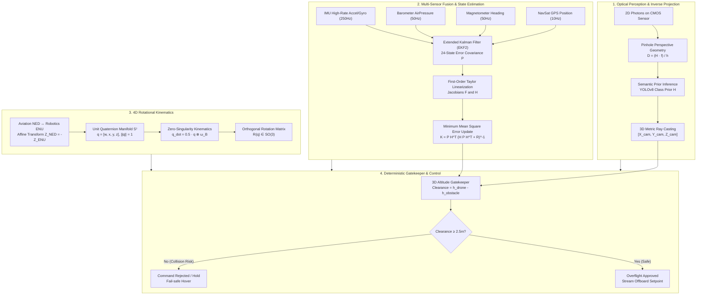

# 📐 Mathematical & Physical Foundations of Autonomous Aerial Robotics

> **Executive Summary:** This directory documents the rigorous mathematical models, optical physics, spatial kinematics, and statistical estimation algorithms that power this autonomous drone system. Every equation documented here directly governs the physical behaviors observed in Gazebo Harmonic simulation and PX4 autopilot control.

---

## 🗺️ System Mathematical Architecture

---

## ⚡ Core Mathematical Formulations at a Glance

| Physical Domain | Primary Equation / Operator | Key Variables & Symbols | Physical & Robotic Significance |
| :--- | :--- | :--- | :--- |
| **Monocular Optics** | $$D = \frac{H \cdot f}{h}$$ | $D$: Distance, $H$: Physical Height, $f$: Focal Length, $h$: Pixel Height | Solves monocular scale ambiguity by fusing pinhole geometry with YOLOv8 semantic object priors ($H_{\text{prior}} \approx 1.7\text{m}$). |
| **Stereo Vision** | $$D = \frac{f \cdot B}{d}$$ | $B$: Baseline separation, $d = x_L - x_R$: Pixel disparity | Measures depth to unknown objects without prior size knowledge; object size cancels out via dual-camera triangulation. |
| **Frame Conversion** | $$\begin{bmatrix} x \\ y \\ z \end{bmatrix}_{\text{NED}} = \begin{bmatrix} y \\ x \\ -z \end{bmatrix}_{\text{ENU}}$$ | $\text{NED}$: North-East-Down (PX4), $\text{ENU}$: East-North-Up (ROS 2) | Eliminates axis sign conflict; prevents ROS 2 $+5\text{m}$ climb commands from commanding an underground crash. |
| **Euler Kinematic Singularity** | $$\dot{\psi} = \frac{q \sin\phi + r \cos\phi}{\cos\theta}$$ | $\phi, \theta, \psi$: Roll, Pitch, Yaw; $p, q, r$: Body angular rates | Proves mathematically why 3-axis Euler representation crashes at $\theta = \pm 90^\circ$ ($\div 0$ singularity / Gimbal Lock). |
| **Quaternion Attitude Update** | $$\dot{q} = \frac{1}{2} q \otimes \boldsymbol{\omega}_B$$ | $q \in S^3$: 4D Unit Quaternion, $\boldsymbol{\omega}_B = [0, p, q, r]^T$: Gyro rate | Guarantees singularity-free attitude integration across all orientations (inverted, vertical, aerobatic) without trigonometric division. |
| **Quaternion to Matrix** | $$R(q) = \begin{bmatrix} 1-2(y^2+z^2) & 2(xy-zw) & 2(xz+yw) \\ 2(xy+zw) & 1-2(x^2+z^2) & 2(yz-xw) \\ 2(xz-yw) & 2(yz+xw) & 1-2(x^2+y^2) \end{bmatrix}$$ | $q = [w, x, y, z]$, $R(q) \in SO(3)$ | Fast vector transformation from local Body Frame to Inertial World Frame ($\mathbf{v}^W = R(q) \mathbf{v}^B$) with zero trig functions. |
| **EKF Error Covariance** | $$P_{k\|k-1} = F_k P_{k-1\|k-1} F_k^T + Q$$ | $P$: Covariance matrix, $F$: State Jacobian, $Q$: Process noise | Tracks drone self-doubt over time. Explains why missing Baro/Mag caused $P \to \infty$ and triggered pre-flight takeoff aborts. |
| **Taylor Measurement Jacobian** | $$H = \left.\frac{\partial h(\mathbf{x})}{\partial \mathbf{x}}\right|_{\hat{\mathbf{x}}}$$ | $h(\mathbf{x})$: Non-linear physics model, $H$: Tangent slope | Linearizes curved exponential barometer pressure functions ($P_{\text{air}} = P_0 e^{-kz}$) at the operating point for linear Gaussian updates. |
| **Kalman Gain** | $$K = P H^T (H P H^T + R)^{-1}$$ | $P$: State covariance ($m^2$), $R$: Sensor noise ($Pa^2$), $H$: Slope ($Pa/m$) | Minimizes Mean Squared Error; optimal weight that converts pressure innovation ($Pa$) into height correction ($m$). |
| **Covariance Reduction** | $$P_{\text{new}} = (1 - K H) P$$ | $(1 - KH) < 1.0$: Contraction factor | Mathematically shrinks estimate uncertainty upon processing every sensor measurement, keeping drone hover variance bounded. |

---

## 🎮 Interactive 3D Simulations

Two standalone interactive 3D simulations are included in the repository for hands-on visual exploration:

1. **Gimbal Lock & Quaternion Lab (`simulations/gimbal_lock_simulation.html`)**:
   - Orbit 3 concentric gimbal rings in real-time.
   - Click *Trigger Gimbal Lock* to see the Roll and Yaw rings align at $\text{Pitch} = 90^\circ$, losing a degree of freedom and causing matrix division by zero.
   - Switch to *Quaternion Mode* to see smooth, unconstrained 3D orientation along arbitrary axis vectors.
2. **Human Shoulder vs Robot Arm Lab (`simulations/robot_arm_singularity_sim.html`)**:
   - Visualizes why human 3-DOF ball-and-socket joints can reach anywhere while standard 6-DOF industrial arms are constrained to a 2D sagittal plane.
   - Demonstrates the **Shoulder Singularity ($r = 0$)** when the arm aligns with the base rotation axis.

---

## 📚 Complete Theoretical Documentation

For step-by-step mathematical proofs, ray diagrams, physics derivations, and complete Python code implementations, read:

👉 **[MATHEMATICAL_FOUNDATIONS.md](./MATHEMATICAL_FOUNDATIONS.md)**
