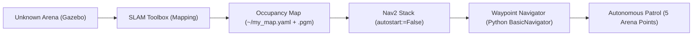

# 🚀 ROS 2 Mini Projects Portfolio

<div align="center">

[](https://docs.ros.org/)
[](https://www.python.org/)
[](https://ubuntu.com/)
[](LICENSE)
[](https://github.com/Nasim-Sami)

**A curated collection of practical, production-oriented ROS 2 robotics projects.**  
Featuring SLAM Mapping, Autonomous Navigation (Nav2), Computer Vision Tracking, AI Gesture Teleoperation, and Industrial Robot Manipulator Motion Planning (MoveIt 2 & OMPL).

[Explore Projects](#-project-catalog) • [Quick Start](#-quick-start) • [Author](#-author)

</div>

---

## 📖 About This Repository

This repository demonstrates hands-on implementation of core robotics disciplines using **ROS 2**:
- **Mobile Robotics**: Real-time 2D SLAM, occupancy grid serialization, Nav2 costmaps, path planners, trajectory controllers, and programmatic waypoint patrol.
- **Perception & Vision**: Closed-loop visual servoing and real-time object tracking using OpenCV and HSV color space.
- **Human-Robot Interaction (HRI)**: Touchless 3D teleoperation combining Google MediaPipe AI Hand Landmark detection with URDF kinematics in RViz.
- **Manipulation & Motion Planning**: 6-DOF industrial arm control (Universal Robots UR3), MoveIt 2 kinematics, trajectory action clients, and OMPL collision-free path planning around obstacles.

---

## 🗂️ Project Catalog

| # | Project Name | Key Technologies | Video Demo | Description |
| :-: | :--- | :--- | :-: | :--- |
| **01** | [**TurtleBot3 SLAM & Autonomous Navigation**](01_TurtleBot3_SLAM_and_Autonomous_Navigation/) | `Nav2`, `SLAM Toolbox`, `Gazebo`, `Python API` | [🎬 Watch](01_TurtleBot3_SLAM_and_Autonomous_Navigation/turtlebot3_slam_navigation_demo.webm) | Full SLAM mapping, map serialization, lifecycle management (`autostart:=False`), and automated waypoint patrol. |
| **02** | [**TurtleBot3 Vision Color Tracking**](02_TurtleBot3_Vision_Color_Tracking/) | `OpenCV`, `HSV Tracking`, `TwistStamped` | [🎬 Watch](02_TurtleBot3_Vision_Color_Tracking/turtlebot3_color_tracking_demo.webm) | Real-time object tracking and visual servoing driving the robot toward target colors. |
| **03** | [**SCARA Hand Gesture Teleoperation**](03_SCARA_Hand_Gesture_Teleop/) | `MediaPipe AI`, `URDF`, `JointState`, `RViz2` | [🎬 Watch](03_SCARA_Hand_Gesture_Teleop/scara_hand_gesture_teleop_demo.webm) | Touchless hand-tracking teleoperation controlling a 4-DOF SCARA robot live in RViz. |
| **04** | [**UR3 Pick & Place Obstacle Avoidance**](04_UR3_Pick_and_Place_Obstacle_Avoidance/) | `MoveIt 2`, `OMPL`, `ros2_control`, `UR3` | [🎬 Watch](04_UR3_Pick_and_Place_Obstacle_Avoidance/ur3_obstacle_avoidance_ompl_demo.webm) | Industrial arm manipulation with sampling-based OMPL collision avoidance around obstacles. |

---

## 🌟 Featured Project Spotlight: TurtleBot3 SLAM & Nav2 Waypoint Navigator

The primary highlight in this repository is **Project 01**, implementing an end-to-end mobile robot autonomy pipeline:



### Key Highlights:
1. **Zero-Prior SLAM**: The robot maps an arena without prior map knowledge; `map → odom` transform is maintained dynamically by SLAM Toolbox.
2. **Deterministic Lifecycle (`autostart:=False`)**: By disabling automatic transition to `Active`, the operator retains explicit control over when the planner, controller, and costmaps boot up.
3. **Automated Waypoint Mission**: The Python script [`turtlebot3_waypoint_navigator.py`](01_TurtleBot3_SLAM_and_Autonomous_Navigation/turtlebot3_waypoint_navigator.py) sequentially commands the robot around 5 key perimeter waypoints, monitoring task completion states (`TaskResult.SUCCEEDED`).

👉 **Read the complete step-by-step guide in [Project 01 README](01_TurtleBot3_SLAM_and_Autonomous_Navigation/README.md).**

---

## 📁 Repository Structure

```text
ROS2-Mini-Projects/
├── README.md                                          # Main repository portfolio documentation
├── LICENSE                                            # MIT License
├── .gitignore                                         # ROS 2 & Python ignore rules
│
├── 01_TurtleBot3_SLAM_and_Autonomous_Navigation/      # Mobile Robot Autonomy
│   ├── README.md                                      # Step-by-step SLAM & Nav2 guide
│   ├── turtlebot3_waypoint_navigator.py               # Autonomous waypoint patrol script
│   ├── turtlebot3_slam_navigation_demo.webm           # Video demonstration
│   └── maps/
│       ├── my_map.yaml                                # Saved map metadata
│       └── my_map.pgm                                 # Saved map occupancy grid
│
├── 02_TurtleBot3_Vision_Color_Tracking/               # Vision-based Servoing
│   ├── README.md                                      # Color teleoperation guide
│   ├── color_control.py                              # Real-time tracking node
│   ├── hsv_tune.py                                   # Interactive calibration tool
│   ├── cam_test.py                                   # Camera verification
│   └── turtlebot3_color_tracking_demo.webm            # Video demonstration
│
├── 03_SCARA_Hand_Gesture_Teleop/                      # Human-Robot Interaction
│   ├── README.md                                      # AI Gesture Teleop guide
│   ├── scara_robot.urdf                              # Kinematic model
│   ├── scara_display.launch.py                       # RViz visualization launcher
│   ├── scara_gesture_control.py                      # MediaPipe joint mapper
│   ├── hand_test.py                                  # Standalone landmark test
│   └── scara_hand_gesture_teleop_demo.webm            # Video demonstration
│
└── 04_UR3_Pick_and_Place_Obstacle_Avoidance/          # Industrial Arm Manipulation
    ├── README.md                                      # MoveIt 2 & OMPL guide
    ├── ur3_pick_and_place.py                         # JointTrajectory action client
    ├── ur3_moveit_autonomous.py                      # MoveIt 2 planning script
    ├── ur3_pick_and_place_obstacle.py                # Collision avoidance script
    ├── ur3_obstacle_avoidance_ompl_demo.webm         # Obstacle avoidance video
    └── ur3_pick_and_place_demo.webm                  # Pick & place trajectory video
```

---

## ⚡ Quick Start

### 1. Clone the Repository
```bash
git clone https://github.com/Nasim-Sami/ROS2-Mini-Projects.git
cd ROS2-Mini-Projects
```

### 2. Install Core ROS 2 Dependencies
```bash
sudo apt update
sudo apt install -y \
  ros-$ROS_DISTRO-nav2-bringup \
  ros-$ROS_DISTRO-slam-toolbox \
  ros-$ROS_DISTRO-turtlebot3-gazebo \
  ros-$ROS_DISTRO-nav2-simple-commander \
  ros-$ROS_DISTRO-teleop-twist-keyboard \
  ros-$ROS_DISTRO-moveit \
  ros-$ROS_DISTRO-ur \
  ros-$ROS_DISTRO-ur-simulation-gz
```

### 3. Launch Any Project
Follow the dedicated instructions inside each project folder:
- [TurtleBot3 SLAM & Navigation Guide](01_TurtleBot3_SLAM_and_Autonomous_Navigation/)
- [Color Tracking Teleoperation Guide](02_TurtleBot3_Vision_Color_Tracking/)
- [SCARA Gesture Teleoperation Guide](03_SCARA_Hand_Gesture_Teleop/)
- [UR3 Obstacle Avoidance Guide](04_UR3_Pick_and_Place_Obstacle_Avoidance/)

---

## 👨‍💻 Author

**Nasim Samiu**  
- **GitHub:** [@Nasim-Sami](https://github.com/Nasim-Sami)  
- **Focus Areas:** Autonomous Mobile Robots (AMR), SLAM, Path Planning, Manipulation, Computer Vision, and ROS 2 Architecture.

---

## 📄 License

This repository is licensed under the [MIT License](LICENSE). Feel free to use, modify, and build upon these projects.
